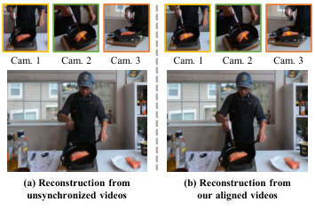
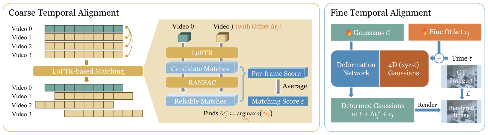
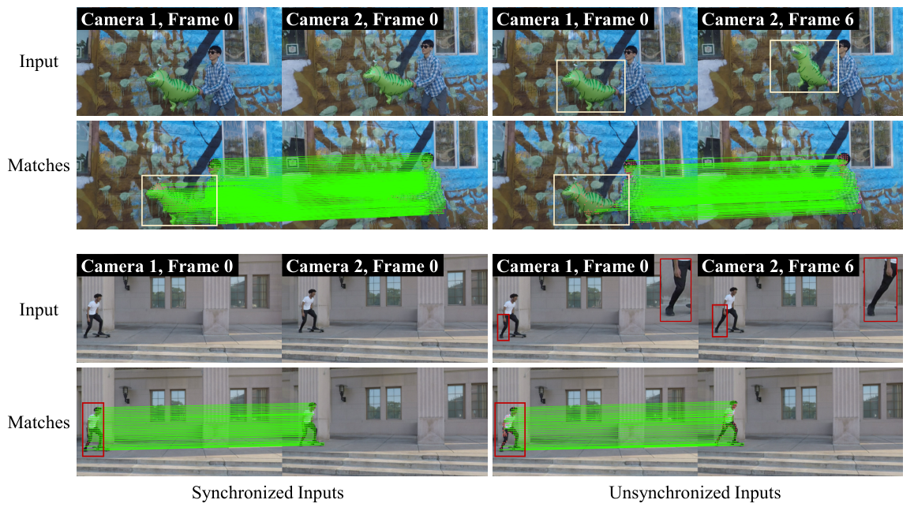
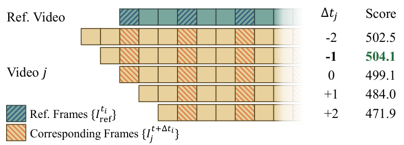
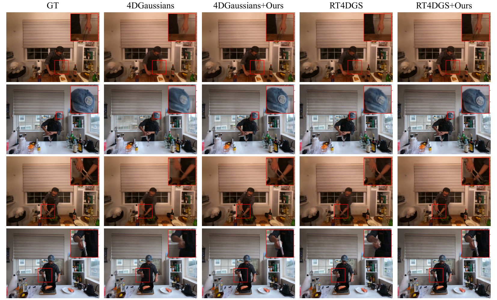
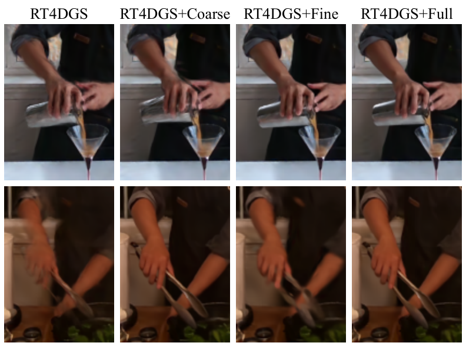

<div align="center">

# Dynamic Gaussian Scene Reconstruction from Unsynchronized Videos

**AAAI 2026**

Zhixin Xu · Hengyu Zhou · Yuan Liu · Wenhan Xue · Hao Pan · Wenping Wang · Bin Wang

[](https://arxiv.org/abs/2511.11175)
[](https://arxiv.org/pdf/2511.11175)


**Coarse-to-fine temporal alignment for dynamic Gaussian reconstruction from unsynchronized multi-view videos.**

</div>

> **Code is coming soon.** This repository currently hosts the paper overview, figures, and reported results. Implementation and usage instructions will accompany the code release.

[Overview](#overview) · [Method](#method) · [Results](#results) · [Ablations](#ablations) · [Citation](#citation)

## Overview

Most dynamic Gaussian reconstruction methods assume that all cameras observe a scene at the same time. Independent recording or camera trigger delays violate this assumption: matching frame indices can show different stages of motion, producing blur, ghosting, and inconsistent geometry.

We introduce a temporal alignment module that estimates a time shift for each camera and integrates it into existing 4D Gaussian reconstruction pipelines. A discrete, frame-level search provides an initial alignment; continuous refinement then learns residual sub-frame offsets jointly with the scene representation.



*Figure 1 from the paper. Examples of improved dynamic reconstruction after adding the temporal alignment module.*

- **Coarse-to-fine alignment:** combine robust integer-frame initialization with learnable sub-frame refinement.
- **Foreground-aware matching:** score temporal candidates using geometrically consistent feature matches on the moving subject.
- **Multiple representations:** evaluated with SC-GS, 4DGaussians, and RT4DGS.

## Method



*Figure 2. Coarse alignment estimates frame offsets; fine alignment optimizes a residual offset with the reconstruction loss.*

For camera $j$, the aligned timestamp is

$$
t' = t + \Delta t_j^{*} + \tau_j,
$$

where $\Delta t_j^{*}$ is the coarse offset and $\tau_j$ is a learnable continuous correction. The model assumes a **constant time shift per camera**.

### 1. Coarse temporal alignment

1. Obtain foreground masks using a pre-trained video segmentation model.
2. Choose a reference video and sample reference frames.
3. Search candidate integer-frame offsets in $[-k,k]$ for every other video.
4. Extract LoFTR correspondences, keep foreground matches, and fit a fundamental matrix with RANSAC.
5. Select the offset that maximizes the aggregated number of foreground inliers across sampled frame pairs.

<details>
<summary><strong>View feature matching and offset search</strong></summary>



*Figure 3. Geometrically consistent foreground matches provide the alignment score.*



*Figure 4. Candidate offsets determine which frames are matched to the reference stream.*

</details>

### 2. Fine temporal refinement

A per-camera residual $\tau_j$ is optimized jointly with the Gaussian scene parameters using the photometric reconstruction loss. This compensates for temporal discrepancies below the frame interval.

| Representation | Integration |
| --- | --- |
| Neural deformation (4DGaussians, SC-GS) | Query the deformation network at the aligned timestamp and backpropagate through its temporal input. |
| Direct 4D Gaussians (RT4DGS) | Use finite differences to estimate the loss derivative with respect to time when the original implementation does not expose that gradient. |

Coarse alignment is a separate preprocessing stage; fine refinement requires integration into the baseline. The reported RT4DGS experiments use a finite-difference step of **1/30 of a frame interval**.

## Results

### Evaluation setup

- **Dataset:** six DyNeRF scenes, with approximately 20 views and 9-second clips per scene.
- **Asynchronous inputs:** videos are subsampled to **15 FPS** and perturbed by random temporal offsets of up to **10 frames**.
- **Task:** novel view synthesis.
- **Metrics:** PSNR (dB) and SSIM — higher is better; LPIPS — lower is better.
- **Implementation:** COLMAP initialization; baseline hyperparameters are retained. 4DGaussians and SC-GS experiments use an RTX 3090, and RT4DGS experiments use an RTX A6000.

### Quantitative comparison

The following are **arithmetic means over the six scenes in Table 1**, calculated from the paper's displayed per-scene values. These are summaries of the published results, not new experimental runs.

| Method | PSNR ↑ | SSIM ↑ | LPIPS ↓ |
| --- | --- | --- | --- |
| Sync-Nerf | 29.11 | 0.918 | 0.126 |
| SC-GS | 29.43 | 0.933 | 0.100 |
| SC-GS+Ours | 29.73 | 0.935 | 0.096 |
| 4DGaussians | 29.60 | 0.935 | 0.099 |
| 4DGaussians+Ours | 31.16 | 0.942 | 0.092 |
| RT4DGS\* | 30.39 | 0.944 | 0.073 |
| RT4DGS\*+Ours | 31.68 | 0.952 | 0.062 |

**RT4DGS\*** and **RT4DGS\*+Ours** use half-resolution evaluation, following the paper. Compare each baseline with its corresponding +Ours variant; cross-method rankings are affected by this resolution difference.

On these six-scene averages, temporal alignment raises PSNR by **1.56 dB for 4DGaussians**, **1.29 dB for RT4DGS\***, and **0.30 dB for SC-GS**. Improvements are not uniform for every scene and metric; the complete values are provided below.

<details>
<summary><strong>Full per-scene results — Table 1</strong></summary>

### Coffee Martini

| Method | PSNR ↑ | SSIM ↑ | LPIPS ↓ |
| --- | --- | --- | --- |
| Sync-Nerf | 27.64 | 0.893 | 0.147 |
| SC-GS | 26.81 | 0.906 | 0.113 |
| SC-GS+Ours | 25.68 | 0.898 | 0.125 |
| 4DGaussians | 26.44 | 0.905 | 0.120 |
| 4DGaussians+Ours | 28.01 | 0.918 | 0.108 |
| RT4DGS\* | 27.92 | 0.919 | 0.085 |
| RT4DGS\*+Ours | 28.35 | 0.924 | 0.079 |

### Cook Spinach

| Method | PSNR ↑ | SSIM ↑ | LPIPS ↓ |
| --- | --- | --- | --- |
| Sync-Nerf | 28.90 | 0.918 | 0.132 |
| SC-GS | 30.53 | 0.939 | 0.104 |
| SC-GS+Ours | 31.54 | 0.947 | 0.089 |
| 4DGaussians | 31.44 | 0.946 | 0.098 |
| 4DGaussians+Ours | 32.57 | 0.951 | 0.089 |
| RT4DGS\* | 31.15 | 0.948 | 0.077 |
| RT4DGS\*+Ours | 33.15 | 0.962 | 0.059 |

### Cut Roasted Beef

| Method | PSNR ↑ | SSIM ↑ | LPIPS ↓ |
| --- | --- | --- | --- |
| Sync-Nerf | 29.96 | 0.925 | 0.125 |
| SC-GS | 31.13 | 0.943 | 0.095 |
| SC-GS+Ours | 31.37 | 0.949 | 0.084 |
| 4DGaussians | 31.37 | 0.941 | 0.096 |
| 4DGaussians+Ours | 31.71 | 0.948 | 0.093 |
| RT4DGS\* | 31.43 | 0.953 | 0.072 |
| RT4DGS\*+Ours | 32.94 | 0.963 | 0.056 |

### Flame Salmon

| Method | PSNR ↑ | SSIM ↑ | LPIPS ↓ |
| --- | --- | --- | --- |
| Sync-Nerf | 27.00 | 0.890 | 0.150 |
| SC-GS | 26.83 | 0.912 | 0.105 |
| SC-GS+Ours | 27.10 | 0.915 | 0.102 |
| 4DGaussians | 28.01 | 0.917 | 0.109 |
| 4DGaussians+Ours | 29.53 | 0.923 | 0.103 |
| RT4DGS\* | 27.78 | 0.923 | 0.080 |
| RT4DGS\*+Ours | 28.79 | 0.929 | 0.070 |

### Flame Steak

| Method | PSNR ↑ | SSIM ↑ | LPIPS ↓ |
| --- | --- | --- | --- |
| Sync-Nerf | 30.66 | 0.942 | 0.093 |
| SC-GS | 30.34 | 0.947 | 0.096 |
| SC-GS+Ours | 31.46 | 0.953 | 0.081 |
| 4DGaussians | 30.68 | 0.952 | 0.087 |
| 4DGaussians+Ours | 32.63 | 0.955 | 0.077 |
| RT4DGS\* | 31.13 | 0.956 | 0.068 |
| RT4DGS\*+Ours | 33.34 | 0.968 | 0.050 |

### Sear Steak

| Method | PSNR ↑ | SSIM ↑ | LPIPS ↓ |
| --- | --- | --- | --- |
| Sync-Nerf | 30.50 | 0.938 | 0.110 |
| SC-GS | 30.92 | 0.950 | 0.085 |
| SC-GS+Ours | 31.20 | 0.949 | 0.092 |
| 4DGaussians | 29.67 | 0.947 | 0.082 |
| 4DGaussians+Ours | 32.51 | 0.959 | 0.080 |
| RT4DGS\* | 32.94 | 0.965 | 0.058 |
| RT4DGS\*+Ours | 33.51 | 0.968 | 0.055 |

</details>

[Download per-scene results as CSV](assets/results.csv) · [Original Table 1](https://arxiv.org/html/2511.11175v1#Sx5.T1)

### Qualitative comparison



*Figure 5. Ground truth, original baselines, and +Ours results on four DyNeRF scenes. The close-ups illustrate reduced blur and ghosting in dynamic regions.*

## Ablations

### Coarse and fine alignment

The values below are reproduced from **Table 2**.

| Variant | PSNR ↑ | SSIM ↑ | LPIPS ↓ |
| --- | --- | --- | --- |
| 4DGaussians | 29.56 | 0.935 | 0.099 |
| 4DGaussians+Coarse | 30.92 | 0.943 | 0.092 |
| 4DGaussians+Fine | 30.87 | 0.941 | 0.091 |
| 4DGaussians+Full | 31.16 | 0.942 | 0.091 |

The full model achieves the highest PSNR and ties Fine-only on LPIPS; Coarse-only has the highest SSIM in this table.

<details>
<summary><strong>View qualitative ablation</strong></summary>



*Figure 6. Visual ablation on RT4DGS: baseline, coarse-only, fine-only, and full alignment. The numerical table above reports 4DGaussians, as in Table 2 of the paper.*

</details>

### Robustness to temporal offsets

**Table 3** compares 4DGaussians with and without our module under maximum random offsets of 3, 5, and 10 frames.

| Max. offset (frames) | Baseline PSNR ↑ | Baseline SSIM ↑ | Baseline LPIPS ↓ | +Ours PSNR ↑ | +Ours SSIM ↑ | +Ours LPIPS ↓ |
| --- | --- | --- | --- | --- | --- | --- |
| 3 | 30.69 | 0.938 | 0.097 | 31.25 | 0.943 | 0.092 |
| 5 | 30.31 | 0.938 | 0.097 | 31.29 | 0.943 | 0.091 |
| 10 | 29.60 | 0.935 | 0.099 | 31.16 | 0.942 | 0.091 |

The 10-frame setting improves PSNR from **29.60 to 31.16 dB**. Tables 1–3 are reported separately as in the paper; the ablation baseline values are not substituted for the six-scene means above.

## Citation

```bibtex
@misc{xu2025dynamicgaussian,
  title         = {Dynamic Gaussian Scene Reconstruction from Unsynchronized Videos},
  author        = {Zhixin Xu and Hengyu Zhou and Yuan Liu and Wenhan Xue and Hao Pan and Wenping Wang and Bin Wang},
  year          = {2025},
  eprint        = {2511.11175},
  archivePrefix = {arXiv},
  primaryClass  = {cs.CV},
  url           = {https://arxiv.org/abs/2511.11175}
}
```

## Sources and acknowledgments

This overview, the six figures, and the numerical results are based on [arXiv:2511.11175v1](https://arxiv.org/html/2511.11175v1). See [asset sources](assets/SOURCES.md) for the original figure links. We thank the authors of DyNeRF, LoFTR, SC-GS, 4DGaussians, and RT4DGS for their contributions to the research community.
